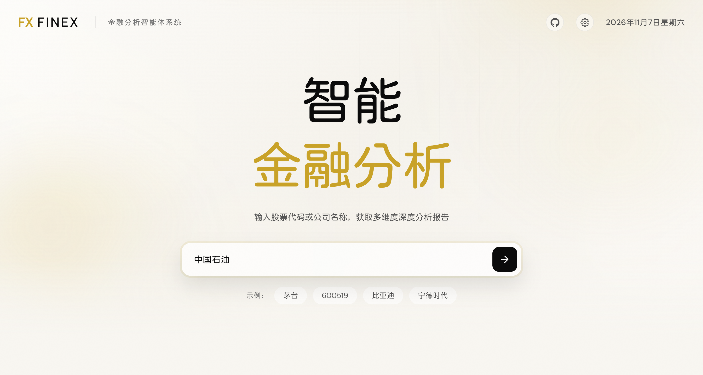
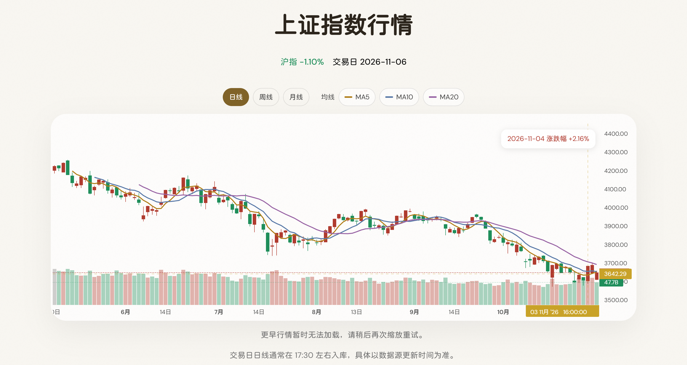

# FINEX · AI 股票研究工作台

基于 LangGraph 与 MCP 的 A 股研究工具。输入公司名称或股票代码，由**基本面、技术面、估值和新闻**四路分析协作生成综合研报，支持在线阅读和文件导出。


<details>
<summary>查看分析工作台与报告</summary>





</details>

## 能做什么

- **多维度研究**：四路分析并行运行，汇总依据、分歧与风险；数据来自 MCP 行情、财务及新闻工具。
- **行情查看**：展示上证指数日终行情及交易日期，研究页查看个股历史 K 线。
- **进度与重试**：查看各角色状态与已完成结果，失败后可重试单项分析或综合研判；支持删除历史任务及对应报告文件。
- **报告阅读与导出**：在线查看、导出 Markdown，或生成含独立摘要、目录和中文排版的 PDF。
- **结果校验与恢复**：缺失维度明确标注；截断或取数预算耗尽时，尝试用已取得的有效资料完成一次精简收尾。四路分析均无有效结果时停止汇总。
- **取数复用**：同一次研究中复用成功结果，相同参数的并发请求共用一次取数；按角色限制工具范围和新增请求次数。
- **可选链路追踪**：接入 LangSmith 后，按分析 ID 查看模型调用、供应商返回的 token 用量、错误及数据工具耗时。

四路分析并行不代表数据请求全部并发：BaoStock 访问由跨进程锁串行保护。数据覆盖、更新日期和可用性以实际数据源返回为准。

## 工作流程

```text
浏览器 → FastAPI → LangGraph 四路分析 → 综合研判 → Markdown / PDF
                       ↓
                  MCP 数据工具
```

模型通过 OpenAI 兼容接口调用，数据工具接入 BaoStock 与新闻来源。PDF 使用 Pandoc 和 XeLaTeX / Tectonic 在本机排版。

## 快速开始

需要 Python 3.10+、可用的 OpenAI 兼容模型接口，以及访问模型和数据源的网络环境。前端随后端提供，无需单独构建；Node.js 仅用于前端测试。

### 1. 获取项目并安装依赖

```bash
git clone --branch v2.0 https://github.com/Curzsu/Stock_Agent.git
cd Stock_Agent
python -m venv venv
```

激活虚拟环境：

```powershell
# Windows PowerShell
.\venv\Scripts\Activate.ps1
```

```bash
# Linux / macOS
source venv/bin/activate
```

```bash
python -m pip install -r requirements.txt
```

项目依赖包含 `uv`，后端通过它启动 MCP 数据服务；首次启动可能需要下载 MCP 依赖。

### 2. 配置模型

将 `agents/.env.example` 复制为 `agents/.env`：

```powershell
# Windows PowerShell
Copy-Item agents/.env.example agents/.env
```

```bash
# Linux / macOS
cp agents/.env.example agents/.env
```

编辑 `agents/.env`：

```dotenv
OPENAI_COMPATIBLE_API_KEY=your-api-key
OPENAI_COMPATIBLE_BASE_URL=https://your-provider.example/v1
OPENAI_COMPATIBLE_MODEL=your-model-id
USE_LOCAL_MODEL=api
```

选择支持工具调用的模型，Base URL 和模型 ID 按供应商配置填写。Gemini 兼容方式见 [开发与排障说明](docs/development.md)。

### 3. 启动并发起研究

在项目根目录运行：

```bash
python -m uvicorn backend.server:app --host 127.0.0.1 --port 8100
```

打开 [http://localhost:8100](http://localhost:8100)，输入公司名称或股票代码开始研究。也可使用 [Windows 启动脚本](scripts/start_server.bat) 或 [Linux/macOS 启动脚本](scripts/start_server.sh)。

模型配置修改后需重启服务。页面中的 API 配置仅允许通过本机 `localhost`、`127.0.0.1` 或 `[::1]` 修改；更换 Base URL 时需重新填写对应密钥。密钥保存在本机配置中，不要提交到仓库。

## PDF 导出

PDF 在后台独立排版，在线阅读与 Markdown 导出不需要安装 PDF 工具。

Windows x64 可在项目根目录安装便携工具：

```powershell
powershell -ExecutionPolicy Bypass -File scripts/setup_pdf.ps1
```

工具保存在本项目的 `.tools/pdf` 中；换目录或新建工作区后需确认该目录可用。
Linux/macOS 需安装 Pandoc 3，以及 XeLaTeX 或 Tectonic。默认优先使用 XeLaTeX，Tectonic 首次排版需联网下载 LaTeX 包。

已有 Markdown 可重新排版，无需重新调用模型：

```bash
python scripts/generate_pdf.py "agents/reports/md/report_example.md"
```

旧 PDF 不会自动更新。安装、字体和输出路径说明见 [开发与排障说明](docs/development.md)，主题与资源许可证见 [PDF 模板说明](agents/src/utils/pdf_templates/README.md)。

## 运行与排障

- **分析慢或失败**：先检查模型结束原因与工具错误，区分模型生成、数据等待及 PDF 排版。模型与供应商的输出限制会影响结果完整性。
- **追踪分析过程**：LangSmith 默认关闭，按 [追踪配置说明](docs/langsmith.md) 启用。项目使用维护中的 `langchain-ai/langsmith-python` SDK。供应商未返回用量或请求超时前未返回时，精确 token 仍可能未知；开启后会上传研究输入、输出等追踪数据，可配置隐藏正文和采样比例。
- **BaoStock 访问保护**：跨进程串行访问，并按北京时间自然日统计实际 SDK 请求，默认每日预算 45000 次。收到 `10001011` 后默认本地暂停 6 小时，记录在重启后保留；暂停到期不代表官方已解封。同机多副本需共用 `FINEX_BAOSTOCK_STATE_DIR`，不同机器的访问需另行协调。
- **历史记录与重启**：任务会话保存在服务进程内存中，重启后不能假定历史列表及重试上下文仍在；已导出的报告文件与会话数据分开保存。

常用配置在 `agents/.env` 中设置，完整选项见 `agents/.env.example`：

| 配置 | 默认值 | 含义 |
| --- | --- | --- |
| `REACT_TIMEOUT_SECONDS` | `480` | 每个分析角色的执行总预算（秒），包含模型调用及工具等待 |
| `ANALYSIS_FINAL_RESERVE_SECONDS` | `90` | 总预算内为精简收尾预留的时间（秒），至多占总预算的三分之一 |
| `SUMMARY_MAX_TOKENS` | `12000` | 综合研判输出上限，需符合供应商限制 |
| `LANGSMITH_TRACING` | `false` | 是否启用云端追踪，还需配置密钥及目标工作区/项目 |
| `PDF_TIMEOUT_SECONDS` | `300` | PDF 排版超时（秒） |

兼容层、工具超时、请求预算和 PDF 故障处理见 [开发与排障说明](docs/development.md)。

## 开发

```text
backend/        FastAPI 接口与研究任务调度
frontend/       首页、研究工作台与报告展示
agents/         LangGraph 分析流程、共享工具与报告生成
mcp-server/     行情、财务与新闻数据工具
finex_data/     BaoStock 共享访问运行时
scripts/        启动、PDF 安装与测试脚本
tests/          应用与前端回归测试
docs/           开发、排障与设计说明
```

### 本地检查

CI 使用 Python 3.10、Node.js 22 和 uv 0.8.12，在 PR 及 `v2.0` 推送后运行离线检查，无需真实模型密钥。
在激活的虚拟环境中执行：

```bash
python -m pip install -r requirements-test.txt
python scripts/run_ci_tests.py app
node --check frontend/workbench.js
node --test tests/frontend/test_workbench.cjs tests/frontend/test_workbench_chart.cjs
uv sync --locked --directory mcp-server --python 3.10
uv run --locked --no-sync --directory mcp-server python ../scripts/run_ci_tests.py mcp
```

完整检查范围见 [CI 设计](docs/ci-design.md)，运行时版本验证见 [开发与排障说明](docs/development.md)。

### API

启动后访问 [交互式 API 文档](http://localhost:8100/docs) 查看参数与接口。发起研究的示例：

```http
POST /api/analyze
Content-Type: application/json

{"query": "比亚迪"}
```

响应返回 `analysis_id`，通过 `/api/status/{analysis_id}` 查询进度，通过 `/api/result/{analysis_id}` 获取结果；健康检查为 `/api/health`。

## 免责声明

本项目仅供学习和研究使用，不构成投资建议。股市有风险，投资需谨慎。
