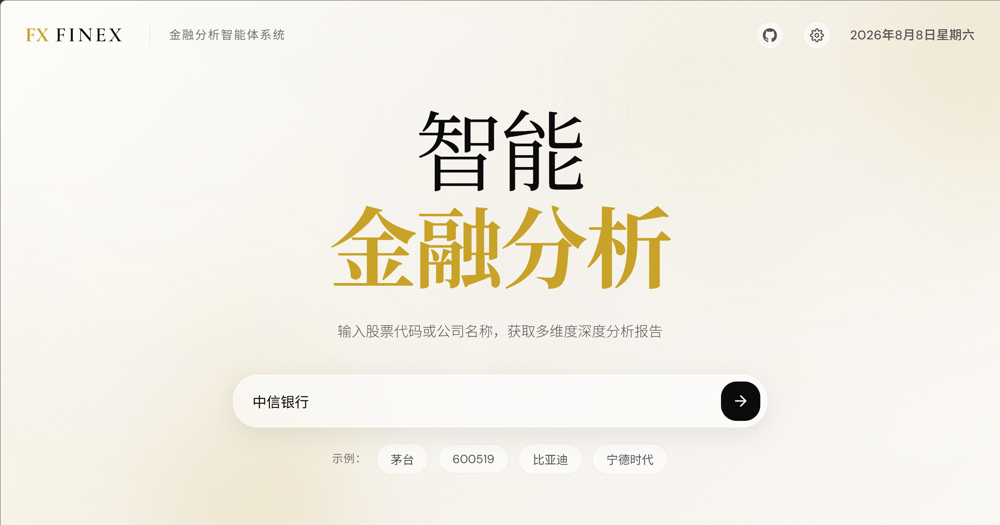
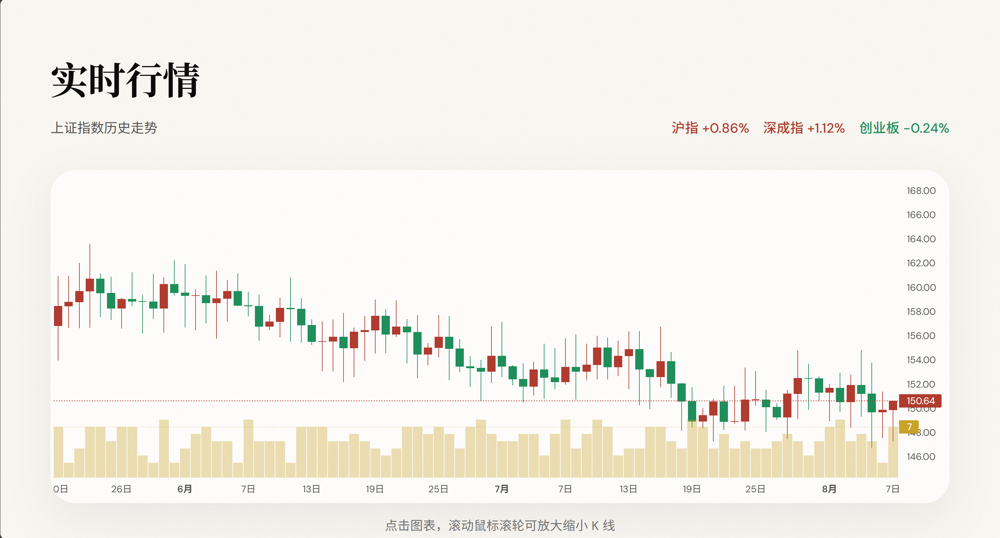

# FINEX - AI 智能股票分析系统

基于 LangGraph 与 MCP 的 A 股分析平台，从基本面、技术面、估值和新闻四个维度生成综合研报。






## 功能特性

- **四路并行分析**：多智能体协作，汇总各维度结论与风险。
- **一页独立摘要**：集中呈现核心判断、依据、风险与后续观察，PDF 摘要独立成页。
- **真实数据接入**：通过 MCP 获取行情与财务数据，首页展示上证指数日终行情及交易日期。
- **进度与恢复**：查看分析进度，支持失败重试和报告重新加载。
- **报告导出**：支持在线阅读、Markdown 和涂鸦风格 PDF，兼容中文、目录与公式。
- **结果校验**：空响应、未完成调用和截断响应判为失败；全部分析失败时停止汇总，部分失败时标明缺失维度。

## 技术架构

```text
前端 → FastAPI → LangGraph → 四路并行分析 → 汇总报告
                                ↓
                           MCP 数据服务
```

后端使用 FastAPI，智能体使用 LangGraph / LangChain 与 OpenAI 兼容 API；数据接入 Baostock 和 A 股行情接口。
PDF 使用 Pandoc 3、Eisvogel 3.5.1 与 XeLaTeX / Tectonic。

## 快速开始

需要 Python 3.10+。MCP 所需的 uv 随项目依赖安装。

1. 克隆项目并创建虚拟环境：

```bash
git clone --branch v2.0 https://github.com/Curzsu/Stock_Agent.git
cd Stock_Agent
python -m venv venv
```

2. 激活虚拟环境：

```powershell
# Windows PowerShell
.\venv\Scripts\Activate.ps1
```

```bash
# Linux/macOS
source venv/bin/activate
```

3. 安装依赖并复制配置模板：

```bash
python -m pip install -r requirements.txt
cp agents/.env.example agents/.env
```

4. 编辑 `agents/.env`，填写模型配置：

```dotenv
OPENAI_COMPATIBLE_API_KEY=your-api-key
OPENAI_COMPATIBLE_BASE_URL=https://api.openai.com/v1
OPENAI_COMPATIBLE_MODEL=your-model-id
USE_LOCAL_MODEL=api
```

5. 启动服务，访问 [http://localhost:8100](http://localhost:8100)：

```bash
python -m uvicorn backend.server:app --host 0.0.0.0 --port 8100
```

也可使用 [Windows 启动脚本](scripts/start_server.bat) 或 [Linux/macOS 启动脚本](scripts/start_server.sh)。
支持输入 A 股公司名称或股票代码，具体数据覆盖以数据源为准。

## 配置说明

配置文件为 `agents/.env`，修改后重启服务。
页面中的 API 配置仅允许通过本机 `localhost`、`127.0.0.1` 或 `[::1]` 修改；更换 Base URL 时需重新输入对应密钥。

| 可选配置 | 默认值 | 用途 |
| --- | --- | --- |
| `SUMMARY_MAX_TOKENS` | `12000` | 汇总输出上限，需符合模型及供应商限制 |
| `PDF_TIMEOUT_SECONDS` | `300` | PDF 生成超时秒数 |
| `BAOSTOCK_BLACKLIST_COOLDOWN_SECONDS` | `21600` | BaoStock 本地暂停秒数，至少为 60 |
| `FINEX_BAOSTOCK_STATE_DIR` | 项目根目录下 `.runtime/baostock` | BaoStock 锁与暂停记录目录 |

Gemini 可使用兼容接口 `https://generativelanguage.googleapis.com/v1beta/openai/`，模型填写账号可用的模型 ID。

BaoStock 返回 `10001011` 后默认暂停连接 6 小时，重启仍生效；到期会尝试重连，实际解封以
[官方黑名单页面](https://www.baostock.com/blacklist) 为准。同机多副本需共用状态目录，请勿删除使用中的 `access.lock`。
兼容层、重试机制与排障细节见 [开发与排障说明](docs/development.md)。

## PDF 报告

PDF 在后台独立生成，在线阅读和 Markdown 不依赖排版工具。

Windows x64 可安装便携工具，无需修改全局 PATH：

```powershell
powershell -ExecutionPolicy Bypass -File scripts/setup_pdf.ps1
```

Linux/macOS 安装 [Pandoc 3](https://pandoc.org/installing.html) 与
[Tectonic](https://tectonic-typesetting.github.io/en-US/install.html)，或具备所需宏包的 XeLaTeX 环境。
默认优先使用 XeLaTeX，其次为 Tectonic；首次使用 Tectonic 需联网下载 LaTeX 包。

为已有 Markdown 重新生成 PDF，无需调用模型：

```bash
python scripts/generate_pdf.py "agents/reports/md/report_example.md" --date 2026-10-31
```

`reports/md/文件名.md` 输出到 `reports/pdf/文件名.pdf`，其他目录则输出到 Markdown 旁边。
旧 PDF 不自动更新；生成失败会标明原因，不提供半成品下载。
字体与工具配置见 [开发与排障说明](docs/development.md)，主题、插画及许可证见 [PDF 模板说明](agents/src/utils/pdf_templates/README.md)。

## 项目结构

```text
backend/        FastAPI 服务与任务调度
frontend/       分析工作台
agents/         分析智能体、共享工具与报告
mcp-server/     行情、财务与新闻数据工具
finex_data/     共享数据访问运行时
scripts/        启动、PDF 安装与测试脚本
tests/          应用与前端测试
docs/           开发与设计文档
```

## 测试

GitHub Actions 在 PR 和 `v2.0` 的 push 后运行 `checks`，执行语法检查、前端测试及应用/MCP 离线回归，无需 API Key。
本地使用 Python 3.10、Node.js 22 和 uv 0.8.12：

```bash
python -m compileall -q backend agents/src mcp-server/src mcp-server/mcp_server.py scripts tests mcp-server/tests
node --check frontend/workbench.js
node --test tests/frontend/test_workbench.cjs
python -m pip install -r requirements-test.txt
python scripts/run_ci_tests.py app
uv sync --locked --directory mcp-server --python 3.10
uv run --locked --no-sync --directory mcp-server python ../scripts/run_ci_tests.py mcp
```

运行时版本检查命令见 [开发与排障说明](docs/development.md)，CI 范围和仓库必过检查设置见 [CI 设计](docs/ci-design.md)。

## API

| 方法 | 路径 | 用途 |
| --- | --- | --- |
| POST | `/api/analyze` | 启动分析，返回 `analysis_id` |
| GET | `/api/status/{analysis_id}` | 查询各维度状态与进度 |
| GET | `/api/result/{analysis_id}` | 获取分析结果 |
| GET | `/api/health` | 健康检查 |

启动分析的 JSON 请求体：

```json
{"query": "比亚迪"}
```

接口参数与在线调试见服务启动后的 [交互式 API 文档](http://localhost:8100/docs)。

## 免责声明

本项目仅供学习和研究使用，不构成任何投资建议。股市有风险，投资需谨慎。
