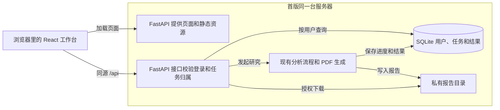

# FINEX React 前端技术架构

建议 FINEX 首版采用 **React + TypeScript + Vite**，按业务组织成一个前端应用。构建后的文件随 FastAPI 发布。客户在同一个域名下登录、发起研究、查看自己的历史和下载研报，线上只需维护一个应用服务。以后可以单独发布前端，业务组件继续通过相对路径 `/api` 访问后端。[Vite 静态部署说明](https://vite.dev/guide/static-deploy.html)

已确定的产品约束是每位客户只能访问自己的任务和研报。首批人数及并发量未知。下文以**单个 FastAPI 服务进程、有持久磁盘、运营者预开首批账号**作为实施默认值。



## 现有代码决定了什么

- 当前首页有 4,268 行，包含样式、接口调用、后台轮询和报告展示。工作台已经把阶段判断、局部结果和行情转换抽成了可测试的函数。迁移时先复用这些规则，保留原有配色和交互。[当前首页](../frontend/index.html) · [工作台逻辑](../frontend/workbench.js) · [视觉约定](workbench-ui-reference.md)
- 研究任务由后端异步执行。关闭浏览器不会主动取消任务。当前任务索引存在进程内存里，历史接口从所有会话中取最近 10 条。报告文件即使还在磁盘上，重启也会丢失会话索引。客户上线前需要补齐身份、数据归属和持久化。[FastAPI 实现](../backend/server.py) · [项目运行说明](../README.md)

## 技术选型

| 部分 | 首版选择 | 在 FINEX 中负责什么 |
| --- | --- | --- |
| 页面与构建 | React、TypeScript（`strict`）、Vite、npm 锁文件 | 组件开发、接口字段检查和可重复的静态构建。Node 用于开发和 CI |
| 页面地址 | React Router 声明式路由 | 让每个任务和报告都有可刷新、可收藏的地址。[React Router 文档](https://reactrouter.com/start/declarative/installation) |
| 接口与缓存 | 原生 `fetch`、TanStack Query | 统一读取状态、处理请求错误、复用行情数据，并在重试成功后刷新相关缓存。[TanStack Query 文档](https://tanstack.com/query/latest/docs/framework/react/reference/functions/useQuery) |
| 样式 | CSS Modules、全局 CSS 变量 | 沿用现有色板、字体和布局。业务样式与组件同目录，按钮、弹窗等复用少量公共组件。[Vite CSS Modules](https://vite.dev/guide/features.html#css-modules) |
| 行情图 | 现有 Lightweight Charts | 沿用现有图表 API，锁定验证过的 npm 版本，在行情区域出现时加载。行情模块分别适配指数和个股响应，服务端返回 `ok: false` 时展示原因 |
| 研究正文 | react-markdown、remark-gfm | 展示研究正文时加载，支持财务表格、引用和代码块。禁用原始 HTML，延续现有安全链接及目录标记的回归用例。[工作台测试](../tests/frontend/test_workbench.cjs) · [react-markdown](https://github.com/remarkjs/react-markdown) · [remark-gfm](https://github.com/remarkjs/remark-gfm) |

## 代码放在哪里

```text
frontend/src/
  app/                 路由、登录态入口、QueryClient、页面组合
  features/
    session/           登录、退出和当前用户
    analysis/          发起任务、进度、局部结果和失败重试
    reports/           报告阅读、目录和 PDF 下载
    market/            首页指数、个股行情和 K 线图
    history/           当前用户的任务列表
  shared/
    api/               fetch 封装、统一错误和生成的接口类型
    ui/                Button、Dialog 等跨页面的基础组件
    styles/            颜色、字体、间距和基础样式
```

首页使用 `/`，登录使用 `/login`，个人历史使用 `/app/history`。工作台和报告分别使用 `/app/analysis/:id` 与 `/app/analysis/:id/report`。打开私人报告时如果需要登录，登录后回到原来的站内地址。页面可以组合不同模块公开的组件，每个模块自己的请求、展示规则、组件和测试放在一起。

**交给 AI 改功能时，先指出业务目录和验收行为。** 例如，“给个股 K 线增加一个周期”从 `features/market` 入手。“给研究增加一个维度”则先调整后端工作流和接口，再扩展 `analysis` 对外提供的维度清单，供进度卡和报告目录共用。将来新增自选股，可加 `features/watchlist` 和一条路由，复用行情模块公开的组件。

按照数据的用途确定归属。任务 ID 放 URL，进度、历史和报告放 Query 缓存，输入框、弹窗和图表焦点留在组件里。组件通过业务模块的函数调用接口。先为现有直接返回字典的 FastAPI 接口补齐面向客户的响应模型，再用开发依赖 `openapi-typescript` 生成类型。CI 重新生成后检查差异，可发现 AI 改了后端字段却遗漏前端的情况。[FastAPI 响应模型](https://fastapi.tiangolo.com/tutorial/response-model/) · [openapi-typescript](https://openapi-ts.dev/introduction)

## 一次研究如何运行

1. 登录用户提交股票名或代码，`POST /api/analyze` 返回 `analysis_id` 后打开工作台。建议给每次明确提交生成一个 `Idempotency-Key`，后端以“用户 ID + 提交标识”唯一入库，只有首次创建才调度分析。若响应丢失，客户可从个人历史找回，或手动使用原标识重试并取得同一个 ID。创建和维度重试遇到网络错误时都不自动重发。刷新、后退或从历史打开均按 URL 查询原任务。
2. 由 `analysis/useAnalysisProgress` 统一消费 `/api/status/{id}`。迁移时保留现有约 2 秒的 Worker 后台轮询，把状态写入 Query 缓存。Worker 不可用时才启用前台定时器。切回标签页立即补查，切换任务时终止旧订阅并忽略迟到响应，同一任务的在途状态查询合并。保留现有 30 分钟前端等待上限和单次完成通知。等待超时的用户可以从历史重新查询。
3. 某个研究维度首次完成时读取 `/api/analysis/{id}/partial`。恢复进行中任务时补取已完成维度。所有角色停止运行后，`completed` 和 `degraded` 都读取 `/api/result/{id}`，部分成功的报告显示缺失维度。`error` 显示原因及已有研究片段，可重试的失败项走现有接口。重试成功受理后清理该任务旧结果和 PDF 状态并恢复进度查询。遇到 `409` 重新读取服务端状态。
4. 在线阅读与 PDF 就绪分别显示。当前下载接口在准备中返回带 `detail.status=pending` 的 404，就绪时返回 PDF 文件。只在明确的 `pending` 状态继续定时检查，`failed`、`unavailable` 或无权访问时停止。若成功探测造成明显的重复传输，可增加只返回就绪状态的接口，将文件传输延迟到用户点击下载时。[现有接口与 PDF 响应](../backend/server.py)

## 每位客户的数据边界

| 环节 | 首版约定 |
| --- | --- |
| 登录 | 建议由运营者预开账号，FastAPI 使用成熟认证组件建立同源会话。规划 `POST /api/session` 登录、`GET /api/session` 取得当前用户、`DELETE /api/session` 退出。生产使用 HTTPS，会话 Cookie 使用 `HttpOnly`、`Secure`、`SameSite=Lax`。认证组件校验写请求的来源与 CSRF 令牌。[MDN 会话 Cookie](https://developer.mozilla.org/en-US/docs/Web/HTTP/Guides/Cookies) |
| 任务与文件 | 服务端从会话取得用户 ID，创建任务时写入所有者。历史先按所有者过滤再排序、取最近记录。状态、局部结果、报告、重试和 PDF 下载均按“当前用户 + 任务 ID”查找。未登录返回 401，他人的任务与不存在的任务均返回 404。持久化文件通过受权接口下载，响应结构只提供客户需要的字段 |
| 浏览器 | 私有缓存键含用户 ID，详情再加任务 ID，例如 `['user', userId, 'analysis', id, 'status']`。退出、会话过期或换号时，通过 `BroadcastChannel` 通知各标签页撤下私有内容、取消请求、关闭 Worker、清空旧缓存。页面恢复可见时重新核对会话再展示。私有响应和 PDF 使用 `Cache-Control: no-store`。行情缓存按股票、周期和天数区分。[MDN 标签页通信](https://developer.mozilla.org/en-US/docs/Web/API/Broadcast_Channel_API) |
| 运维与旧数据 | 规划仅宿主机回环可访问的 `/ops`，承接原来的 A–E 模型配置、全局历史与删除，并供运营者开设或停用客户账号。运营者从受保护的运维接口查询全局历史，客户历史接口始终按本人过滤。公网入口屏蔽运维页面、配置接口、运维接口及原有删除方法，后端保留本机访问校验。没有可靠归属的旧报告只在本机归档 |

建议单机试用阶段用持久磁盘上的 SQLite 保存用户、会话、任务归属、进度快照、研究结果和私有报告位置，同时备份数据库与报告目录。浏览器刷新可恢复正在进行的研究。服务重启后，已完成报告仍可读，遗留的运行中任务标为中断并保留已有结果，允许用户重新发起。创建和重试均由服务端执行每用户及全局并发上限，繁忙时返回可重试的反馈。[SQLite 的适用场景](https://www.sqlite.org/whentouse.html)

终态任务中原本允许重试的维度或综合研判，重启后仍可重试。为此要保存初始研究输入、各维度结果及状态、启动时的模型配置版本引用。对应凭据由后端受保护的版本化配置保存，任务表和浏览器只接触各自所需字段。原版本凭据已撤销时明确提示重新发起研究，避免静默切换模型。[项目已有的配置与重试约定](../README.md)

## 发布与扩展

- **首版发布。** CI 构建出 `frontend/dist`，随 Python 应用打包，页面与接口一次发版。FastAPI 在 `/`、`/login` 和已登记的 `/app/*` 页面路由返回入口文件，使详情页刷新正常。只挂载构建后的静态资源。带内容哈希的资源可长期缓存，入口 HTML 每次重新验证。`/api/*` 及缺失资源保持自己的 HTTP 状态。开发时可用 Vite 热更新并将普通 `/api` 请求代理到 `127.0.0.1:8100`，本机运维功能通过 8100 的同源入口验证。
- **页面和资源变多。** 按路由或可见区域加载报告、图表和首页动效，公共样式及核心交互随构建发布。静态流量或发布频率增长时，同一份 `dist` 可交给静态托管或 CDN。通过同域网关继续把 `/api` 指向 FastAPI，私有报告始终经鉴权下载。
- **同时运行的研究变多。** 观察活跃任务数、启动等待、模型限流和状态请求量。以 2 秒轮询为例，20 个正在查看任务的标签页约产生每秒 10 次状态查询，这是估算请求量的口径。若研究积压，先按实测并发和数据源限制调整，再将执行移到持久队列和独立工作进程。需要多台应用服务器时，将状态迁到共享数据库、报告迁到共享私有存储。若轮询本身成为瓶颈，可在进度模块内换成服务端推送，让页面沿用原接口。

## 迁移顺序与验收

逐阶段实施、验收命令和跨会话进度见 [前端重构实施计划](frontend-migration-plan.md)。

| 步骤 | 可交付成果 | 验收行为 |
| --- | --- | --- |
| 1. 并行建入口 | 本地或预发布保留旧首页，React 使用独立 HTML 入口和工作台路由。先迁阶段判断、行情转换、色板和组件 | 现有 Node 测试继续通过。新测试用同一组场景验证状态和行情。K 线保留缩放、滚动、切周期和空数据提示。[行情回归用例](../tests/frontend/test_workbench_chart.cjs) |
| 2. 迁业务流程 | 接通创建、后台进度、局部结果、失败重试、报告、PDF 和历史 | 一条离线浏览器用例从发起研究走到报告。另测刷新恢复、迟到响应、部分成功和 PDF 准备中。将直接匹配旧 HTML 源码的测试逐项换成行为测试 |
| 3. 开放给首批客户 | 接入同源会话、按用户持久化、受权下载和本机运维，再将正式首页切到 React | 双账号验证历史、直达链接和重试隔离。双标签页换号后旧报告撤下。提交响应丢失时只创建一次研究。重启后可读历史、按原配置重试符合条件的失败项。前端回退仍执行相同权限 |

建议在 `frontend/package.json` 提供一个 `npm run check`，串起类型检查、ESLint、Vitest 行为测试与生产构建。锁文件随代码保存。CI 再运行离线浏览器主流程和后端双账号权限测试。当前两组旧前端回归测试在设计时合计通过 73 项，作为迁移基线。

发布包在目标主机做一次冒烟验证。客户 A 能打开自己的报告直链并下载可读的中文 PDF，客户 B 打开同一下载链接得到 404。实际用 Pandoc 3 与 XeLaTeX 或 Tectonic 排版一份样例，同时确认公网访问不了 `/ops`。这一步能发现 CI 模拟接口覆盖不到的字体、工具链及部署路由问题。[PDF 环境说明](../README.md)
